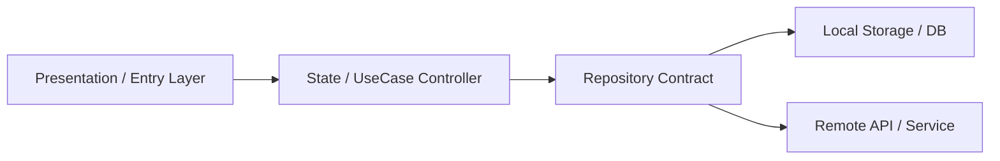

# 🔄 Flujo de Datos Global y Persistencia

> Pertenece a: `overview/architecture/core/data_flow.md`  
> Referenciado desde: [`overview/architecture.md`](../../architecture.md)

## 1. Arquitectura de Estado y Persistencia

## 2. Estrategias de Sincronización
- **Lectura**: Fuente de verdad definida por la capa de dominio/persistencia.
- **Escritura**: Validación contractual previa + persistencia desacoplada.
