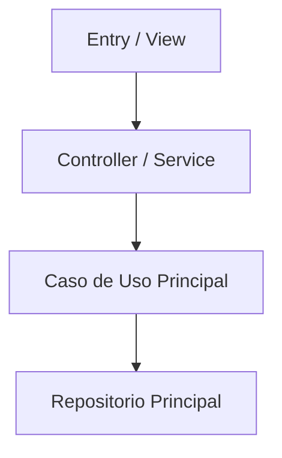

# 📦 Módulo: Principal

> Pertenece a: `overview/architecture/modules/principal.md`  
> Referenciado desde: [`overview/architecture.md`](../../architecture.md)

## 1. Mapa de Enrutamiento Lógico y Flujo Operativo

## 2. Reglas de Negocio del Módulo
* **Regla 1:** Explicación técnica de la regla.
* **Regla 2:** Explicación técnica de la regla.

## 3. Componentes y Servicios Clave
* **Presentation / Entry:** `app/src/main/kotlin/<pkg>/ui/`
* **Domain / Logic:** `app/src/main/kotlin/<pkg>/domain/`
* **Infrastructure / Data:** `app/src/main/kotlin/<pkg>/data/`

## 4. Estado Actual de Refactorización
* [x] Componentes modulares (< 250L por archivo)
* [x] Pruebas y análisis estático limpios (`0 issues`)
